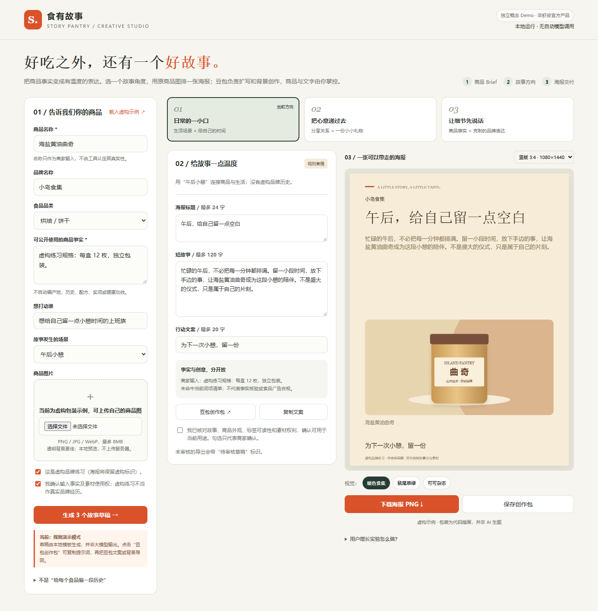

# 食有故事 · Food Story Studio

一个面向食品小商家的故事海报创作原型：提供商品事实与原图，选择故事方向，编辑文案并导出海报。

> 独立概念作品，非 Shopee / 虾皮官方产品。当前为本地规则草稿 + 豆包人工交接；没有自动模型调用、投放数据或真实增长成果。

## 快速体验

[在线体验](https://albert-wucsu.github.io/food-story-studio/) · [源代码](https://github.com/Albert-WuCSU/food-story-studio)

下载或克隆仓库，用较新的 Chrome / Edge 打开 `index.html`，点击「载入虚构示例」。单个 HTML 即可运行，无需账号、API Key 或安装依赖。

1. 输入商品名称、商家确认的事实、目标人群与场景。
2. 上传有权使用的商品图，选择「日常场景 / 分享心意 / 事实表达」三个方向之一。
3. 编辑标题、短故事与行动文案，切换三种视觉主题。
4. 可选：复制豆包故事提示词，手动取回 JSON 并导入；也可生成纯背景并回传。
5. 人工核对事实、商品外观与素材权利，导出 1080×1440 或 1080×1080 PNG。
6. 下载创作记录 JSON，保留本次会话的方向、文案来源与实际操作事件。



## 产品设计

目标用户假设：有商品，但缺少创意文案和设计支持的食品小商家。用「提供事实 → 选方向 → 修改审核」降低首次创作门槛，而不是要求用户从空白提示词开始。

- **故事不等于编历史**：仅围绕生活场景、分享关系与商家输入事实，不自动添加产地、祖传工艺、功效或认证。
- **原商品图保留**：背景创作与商品合成分离，不让模型重新绘制包装；不自动抠图，透明 PNG 效果更佳。
- **文字单独排版**：模型/豆包负责文案和可选背景，Canvas 负责清晰文字与固定画幅。
- **来源与审核可见**：规则草稿、手动修改、用户声明的豆包回传分别标识；修改后撤销旧审核，Brief 变化会提示重新生成。

## 用户增长验证计划

观察真实体验者是否完成有效输入、获得自认为有用的首份素材、导出并为第二件商品实际复用。当前只实现本次会话事件记录，没有独立用户识别、跨会话留存或用户研究结果。

下载请求不是实际发布，也不是销售转化；不能将测试或示例日志作为业务数据。

## 能力边界

- 规则草稿不是 AI 输出；豆包由用户人工操作，来源按用户声明记录。
- 图片在本地预览，没有自动网络请求；用户复制给豆包时才自行进行外部交接。
- 仅中文，尚未做海外市场本地化。
- 敏感词只作提醒，不是事实核验或食品广告合规认证。
- 刷新清空状态；JSON 仅用于记录导出，尚不支持恢复工程文件。
- 示例品牌、商品规格与包装插画均为虚构，不是实际客户或模型生成作品。

## 文件

- `index.html`：单文件原型，全部样式、逻辑和 Canvas 排版。
- `preview-*.png`：界面截图。
- `sample-poster-*.png`：虚构品牌示例海报（规则文案、代码插画）。
- `使用与产品思路.md`：使用说明、实验设计与实现边界。
- `qa/smoke-test.cjs`、`qa/verification.json`：功能检查，不是用户研究。

## 运行检查

检查脚本需要 Node.js、Playwright 与 Chromium。安装开发依赖后执行：

```sh
npm install --no-save playwright
npx playwright install chromium
node qa/smoke-test.cjs
```

也可通过 `PLAYWRIGHT_MODULE` 指定模块路径，通过 `BROWSER_PATH` 指定本机浏览器。浏览器仅用于检查，HTML 本身不依赖这些工具。
